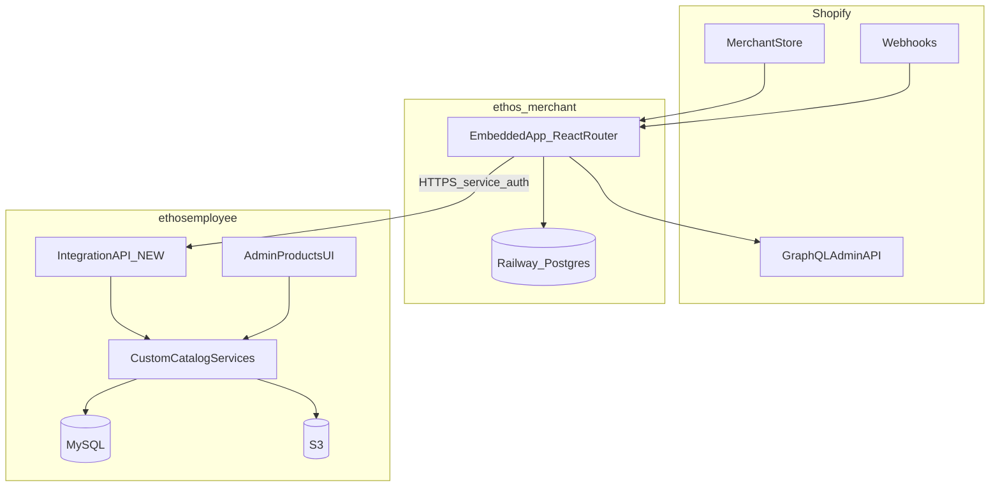

# Repository audit — Ethos Shopify merchant integration

**Date:** 2026-11-04  
**Phase:** 1 (discovery only — no integration code)  
**MySQL destination (confirmed):** Custom supplier catalog (`catalog_custom_*`)

---

## 1. Repositories in scope

| Repository | Path / remote | Role |
|------------|---------------|------|
| **ethos-merchant** | `/Users/williamhunt/Sites/ethos merchant` · `git@github.com:willhunt1994/ethos-merchant.git` | Merchant-facing Shopify embedded app (greenfield) |
| **ethosemployee** | `/Users/williamhunt/Sites/ethosemployee` | Employee admin + API; authoritative product catalog (MySQL) |

---

## 2. ethos-merchant — current state

| Item | Status |
|------|--------|
| Application code | **None** — only `README.md`, `.gitignore`, `.env.example`, local `.env` (gitignored) |
| Git | `main` pushed to GitHub |
| Railway | Project **wonderful-adventure** (production), **Postgres** service linked; `public` schema **empty** (fresh wipe) |
| Prior scaffold | React Router + Prisma app was built under `/Users/williamhunt/Sites/Ethos Merchant`; **source removed** (only `.env` remains). Legacy Railway service **ethos-merchant-shopify** may still point at old GitHub repo — repoint in a later deployment phase |
| Shopify CLI | Installed (`4.7.1` on this machine) |
| Dev store | `ethos-merchant` (`https://admin.shopify.com/store/ethos-merchant`) — per project spec; Partner app credentials not stored in this repo |

**Classification:** Embedded app, Prisma/Postgres integration layer, merchant UI, webhooks → **NEW** (Phase 3+).

---

## 3. ethosemployee — architecture summary

| Layer | Location | Notes |
|-------|----------|--------|
| Admin UI | `apps/admin` (Next.js App Router) | Products at `/products`, suppliers at `/products/suppliers` |
| API | `apps/api` (NestJS host + Express legacy routers) | MySQL via `apps/api/src/db/pool.js` |
| Auth | `apps/api/src/auth/express-auth.middleware.ts` | JWT for employees; permission keys e.g. `nav.products` |
| S3 | `apps/api/src/lib/s3.js`, `apps/api/src/config.ts` | Bucket `AWS_S3_BUCKET`, prefixes `product-media`, `product-cad`, custom media under `custom-products/{slug}/{productId}/` |

**Shopify references in ethosemployee:** **None** (grep across `*.ts`, `*.tsx`, `*.sql`).

---

## 4. Feature audit matrix

Legend: **REUSE** · **EXTEND** · **NEW** · **BLOCKED**

### 4.1 Product creation & updates (custom catalog)

| Feature | Implementation | Key files / tables | Action |
|---------|----------------|-------------------|--------|
| Create supplier | `POST /admin/custom-suppliers` | `catalog_custom_suppliers`, `createCustomSupplier` | **REUSE** |
| Create product | `POST /admin/catalog-stock/custom/:supplierSlug/products` | `catalog_custom_products`, `createCustomProduct` in `apps/api/src/lib/catalog/custom/repository.ts` | **REUSE** via future integration service |
| Update product | `PATCH .../by-item-code/:itemCode`, `PATCH /products/:id` | `updateCustomProduct` | **REUSE** |
| Delete product | `DELETE ...` | `deleteCustomProduct` | **REUSE** (not for automated Shopify sync without policy) |
| Product content (HTML) | `upsertCustomProductContent` | `catalog_custom_product_content.description_html` | **REUSE** |
| Product status | `product_status` enum | `091_custom_product_status.sql` — `available`, `sample`, `discontinued` | **REUSE** |
| Item code allocation | `allocateOnDemandItemCode` | Prefix from supplier `short_code` or slug | **REUSE**; Shopify imports may use `product_code` for external reference |

**Migrations (custom catalog):** `070`–`077`, `073`–`076`, `085`, `091`, `113` (media `source_storage_key`).

### 4.2 Variants & SKUs

| Feature | Implementation | Key files / tables | Action |
|---------|----------------|-------------------|--------|
| Variant replace | `PUT .../variants` | `replaceCustomVariants`, `catalog_custom_variants` | **REUSE** + **transform** Shopify options → `color` / `size` |
| SKU | `supplier_sku` VARCHAR(128), unique per product `(product_id, color, size)` | Default SKU generator `defaultSupplierSku` in repository | **REUSE**; collision with existing `catalog_ethos_skus (supplier, supplier_sku)` must flag review |
| Ethos SKU rows | `ensureEthosSkusForStyle` | `catalog_ethos_skus`, `065_warehouse_locations_ethos_skus.sql` | **REUSE** (Ethos-managed barcodes `E-########`) |
| Barcode (Shopify) | — | No column on `catalog_custom_variants` | **EXTEND** MySQL or store in Postgres mapping only (gap doc) |
| Weight / HS | `weight_oz`, `hs_code` | `076_custom_variant_commerce_fields.sql`, `variant-commerce.ts` | **REUSE** |
| Location inventory JSON | `location_quantities` | `077_custom_variant_location_quantities.sql`, keys are arbitrary strings (Ethos uses `ethos-location:{id}` for warehouses) | **REUSE** with Shopify location GID keys for merchant stock |

**Inventory mode (critical):** `catalog_custom_suppliers.inventory_mode` — `tracked` \| `on_demand` (`084_custom_supplier_inventory_mode.sql`).

- **`tracked`:** Ethos warehouse bin snapshots via `custom-tracked-inventory.ts` — **do not overwrite with Shopify quantities**.
- **`on_demand`:** Variant `quantity` / `location_quantities` cleared on replace in repository when `onDemand` — Shopify sync should use **`on_demand`** for merchant-owned inventory suppliers.

### 4.3 Pricing

| Feature | Implementation | Action |
|---------|----------------|--------|
| Ethos price | `catalog_custom_products.pricing_settings` JSON, `ethosPrice` in `ss-item-pricing.ts` | **REUSE** for merchant-submitted Ethos price |
| Tiered / minimums | Same JSON structure as SS catalog | **REUSE** optional fields; Shopify import can set `ethosPrice` only initially |
| Cost / reference price | `cost_price` JSON on product; variant `cost_price` DECIMAL | **REUSE** for Shopify **retail** reference (display/import only — never write back to Shopify) |

### 4.4 Media & attachments

| Feature | Implementation | Action |
|---------|----------------|--------|
| Custom product images | Presigned PUT + `catalog_custom_product_media` | **REUSE**; keys `custom-products/{slug}/{productId}/...` |
| Source de-duplication | `source_storage_key` unique | **REUSE** when copying Shopify CDN → S3 once |
| Ethos catalog media (stock) | `catalog_ethos_product_media` | **Not** primary target for merchant Shopify products |
| Design / CAD files | `catalog_product_cad`, S3 `{productCadS3Prefix}/{supplier}/{itemCode}/` | **REUSE** / **EXTEND** MIME validation (today CAD upload route emphasizes `.ai`; spec allows PDF, PNG, etc.) |
| CAD API | `registerProductCadRoutes` on `catalogStockRouter` — `/admin/catalog-stock/watch/by-item-code/:itemCode/product-cad` | **REUSE** pattern; custom suppliers supported via `parseWatchListSupplierId` |

### 4.5 Suppliers

| Feature | Implementation | Action |
|---------|----------------|--------|
| Admin CRUD | `/admin/custom-suppliers`, UI `apps/admin/app/products/suppliers` | **REUSE** |
| Slug rules | `isValidCustomSupplierSlug` in `apps/api/src/lib/catalog/custom/slugs.ts` | **REUSE** for mapping validation |

### 4.6 Inventory (Ethos warehouse vs merchant)

| Feature | Implementation | Action |
|---------|----------------|--------|
| Ethos physical stock | `catalog_ethos_skus`, bin inventory, `getCustomTrackedInventory` | **REUSE** for Ethos-owned stock only |
| External / merchant stock | Variant `quantity`, `location_quantities` | **REUSE** when `inventory_mode = on_demand` |
| Distributor catalog inventory | SS/SanMar collectors, etc. | **Not applicable** to Shopify merchant submissions |

### 4.7 Authentication & API integration

| Feature | Implementation | Action |
|---------|----------------|--------|
| Employee session | JWT + permissions | **REUSE** for admin UI |
| Shopify → Employee server calls | — | **NEW** authenticated integration router (API key or signed JWT), idempotency, audit log |
| Merchant → Employee direct from browser | — | **Blocked** — secrets must not ship to embedded app beyond Shopify session |

### 4.8 Shopify-specific (merchant repo)

| Feature | Implementation | Action |
|---------|----------------|--------|
| OAuth / sessions | Shopify app template | **NEW** |
| Product browser UI | — | **NEW** |
| Submission pipeline | — | **NEW** (Postgres + integration API) |
| Webhooks | — | **NEW** |
| Local preview mode | — | **NEW** (dev-only mocks) |

### 4.9 Incoming product review (Employee)

| Feature | Implementation | Action |
|---------|----------------|--------|
| Client products page | `apps/admin/app/products/client-products/page.tsx` | **Placeholder** — **NEW** minimal “incoming Shopify submissions” UX |
| Showroom submission flow | `showroom-scans` routes | **Analog only** — different domain; do not repurpose for catalog import |

---

## 5. API inventory (Employee — product-relevant)

Base URL production: `https://employee.ethos-merch.com` (API path prefix as configured for admin `api()` client).

| Mount | Router | Auth | Purpose |
|-------|--------|------|---------|
| `/admin/custom-suppliers` | `custom-suppliers.ts` | JWT + `nav.products` | Supplier CRUD |
| `/admin/catalog-stock/custom` | `custom-catalog-stock.ts` | JWT + `nav.products` | Custom products, variants, media, inventory |
| `/admin/catalog-stock/watch/.../product-cad` | `product-cad-routes.ts` | JWT + `nav.products` | CAD list/upload (stock + custom slugs) |
| `/admin/catalog-stock` | `catalog-stock.ts` | JWT + `nav.products` | Distributor catalogs (SS, SanMar, …) — **not** Shopify import target |

**Integration endpoints for Shopify:** **NEW** (proposed namespace e.g. `/integrations/shopify/v1/...` with service auth).

---

## 6. S3 configuration (Employee)

From `apps/api/src/config.ts` and `.env.example`:

| Variable | Purpose |
|----------|---------|
| `AWS_ACCESS_KEY_ID`, `AWS_SECRET_ACCESS_KEY`, `AWS_REGION`, `AWS_S3_BUCKET` | Primary private bucket |
| `PRODUCT_MEDIA_S3_PREFIX` | Default `product-media` |
| `PRODUCT_CAD_S3_PREFIX` | Default `product-cad` |
| `PRODUCT_MEDIA_LIBRARY_S3_BUCKET` | Optional library bucket |

Utilities: presigned PUT/GET, `uploadPrivateObject`, `deletePrivateObject` in `s3.ts`.

**Shopify app S3:** Should **not** duplicate credentials in the browser; uploads via merchant app server → presigned URL or proxy upload (Employee API pattern in `custom-catalog-stock` `media/prepare`).

---

## 7. Shopify Admin API version & scopes (audit appendix)

| Decision | Value |
|----------|--------|
| **GraphQL Admin API version (pinned for docs & implementation)** | **`2026-01`** (object reference: [Admin GraphQL latest](https://shopify.dev/docs/api/admin-graphql/latest); webhook template uses `2026-10` in official React Router template — align webhook `api_version` with deployment when scaffolding) |
| **Scopes (read-only catalog + inventory)** | `read_products`, `read_inventory`, `read_locations` |
| **Scopes (media)** | Use product `media` connection on `read_products`; add `read_files` if Files API needed for non-product media |
| **Explicitly omit (per spec)** | `write_products` (do not change merchant retail prices) |
| **Webhooks (planned)** | `PRODUCTS_UPDATE`, `PRODUCTS_DELETE`, `INVENTORY_LEVELS_UPDATE`, `APP_UNINSTALLED` — verify exact topic names for pinned API version at scaffold time |

---

## 8. Environment variables (consolidated)

### ethos-merchant (Railway + local)

| Variable | Required | Notes |
|----------|----------|--------|
| `DATABASE_URL` | Yes | Railway Postgres; TCP proxy or SSH tunnel locally |
| `SHOPIFY_API_KEY`, `SHOPIFY_API_SECRET` | Yes | Partner app |
| `SCOPES` | Yes | See §7 |
| `SHOPIFY_APP_URL` | Yes | Public app URL |
| `ETHOS_INTEGRATION_API_URL` | Yes | Employee API base |
| `ETHOS_INTEGRATION_API_KEY` | Yes | Server-only |
| `LOCAL_PREVIEW` | No | Dev-only mock UI |

### ethosemployee (existing + proposed)

| Variable | Required | Notes |
|----------|----------|--------|
| AWS S3 vars | Yes for media | Existing |
| `SHOPIFY_INTEGRATION_API_KEY` | Yes (new) | Validates incoming integration requests |
| MySQL `DATABASE_URL` | Yes | Existing |

### BLOCKED (need your input)

- Production vs staging Employee API URL for integration testing
- Whether Shopify Partner app from prior Ethos Merchant build is reused or recreated
- MySQL **structural** changes (barcode, country of origin) — approval required

---

## 9. Architecture diagram

---

## 10. Existing functionality inventory (summary)

**Reused as-is:** Custom supplier CRUD, custom product CRUD, variant replace, pricing JSON (`ethosPrice`), variant weight/HS, product media + CAD storage patterns, Ethos SKU generation, S3 presign/upload, employee auth for admin.

**Extended:** CAD MIME/types for merchant attachments; admin UI for submission review; optional MySQL columns for barcode/country of origin.

**New:** Entire Shopify embedded app, Postgres integration schema, shop↔supplier approval mapping, submission/job/webhook pipeline, server-to-server integration API, inventory sync jobs for `on_demand` suppliers.

**Blocked:** Production credentials, MySQL DDL approval, E2E claims until dev store tests run.

---

## 11. Phased implementation checklist (reference — post-approval)

1. ~~Phase 1–2: Audit + field mapping + gap analysis~~ (this deliverable)
2. Phase 3: Scaffold Shopify app + merchant UI shell + local preview
3. Phase 4: S3 upload flow (reuse Employee patterns)
4. Phase 5: Supplier ↔ shop mapping + admin approval
5. Phase 6: Submission pipeline + integration API
6. Phase 7: Employee incoming product review UI
7. Phase 8: Webhooks + inventory/product sync
8. Phase 9: E2E on `ethos-merchant` dev store

**Stop gate:** No Phase 3+ work until you approve this audit, field mapping, and schema gap analysis.
